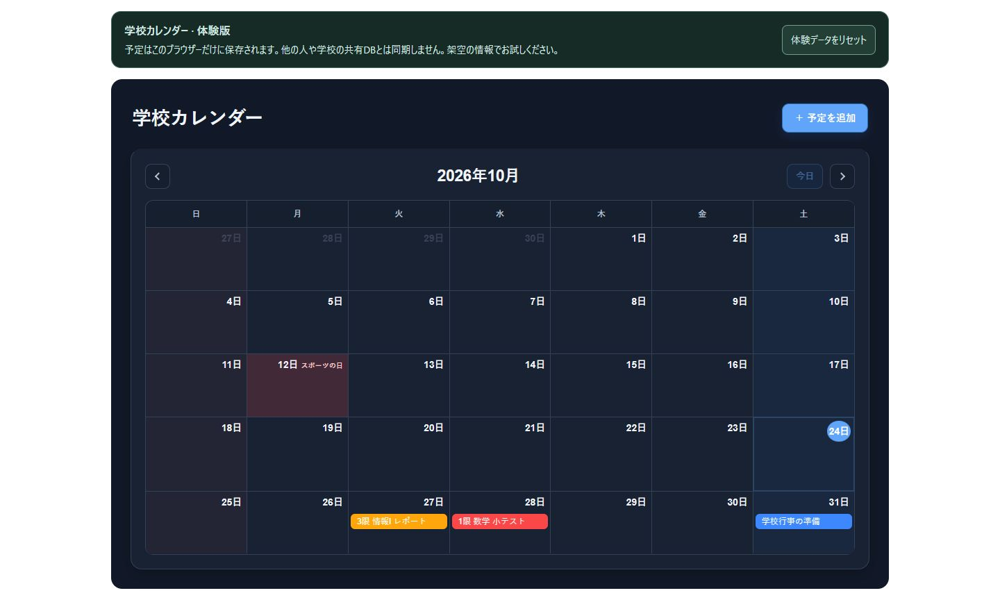
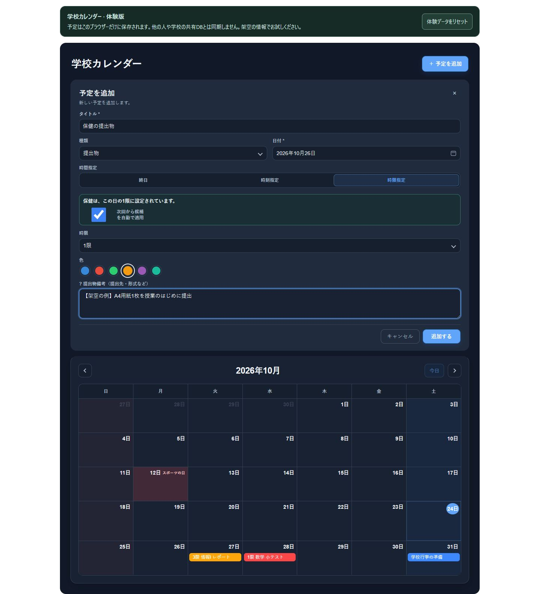
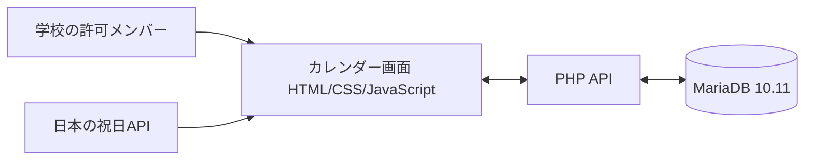

# 学校カレンダー

[**ブラウザー保存型の体験版を開く**](https://huwadora903-oss.github.io/teapot-school-calendar/)

## 確認できた機能

- 学校行事・提出物・テスト・その他の分類と色分け
- 終日・時刻・1〜6限での予定指定
- 提出物の提出先・形式、テストの出題範囲・持ち物の記録
- 教科名のキーワードと通常時間割からの時限提案
- 選んだ曜日に該当教科がない場合の日付確認メッセージ
- 予定の詳細表示・追加・編集・削除・ドラッグによる日付移動
- 画面幅に応じた表示、ダークモード、入力時のエラーメッセージ

元の画面コードをもとにし、デモ用にAPIの接続先とサーバー側の処理を整理しています。
時間割は現在コード内に固定されており、臨時の時間割変更は自動判定しません。

## デモ用の架空の時間割

時限の自動提案には、次の架空の時間割を使用します。実在の学校・クラスの時間割とは無関係です。
デモ作成時に教科をランダムに配置したもので、ページを開くたびに変わるものではありません。

| 時限 | 月曜日 | 火曜日 | 水曜日 | 木曜日 | 金曜日 |
| --- | --- | --- | --- | --- | --- |
| 1限 | 保健 | 英語CI | 数学A | 体育 | 言語文化 |
| 2限 | 英語CI | 数学A | 家庭基礎 | 情報I | 英語CI |
| 3限 | 家庭基礎 | 言語文化 | 論理・表現 | 家庭基礎 | 情報I |
| 4限 | 現代の国語 | 数学I | 保健 | LHR | 音楽I |
| 5限 | 歴史総合 | 保健 | 音楽I | 物理基礎 | 数学I |
| 6限 | 数学A | 情報I | 生物基礎 | 論理・表現 | 家庭基礎 |

例えば、月曜日の日付を選んで「保健の提出物」と入力すると、1限が提案されます。その曜日に該当教科がない場合は、日付の確認メッセージが表示されます。
自動反映を有効にしている場合は、提案された時限を入力欄へ反映します。

## 画面例

予定はすべて架空の説明用データです。本番の学校用サーバーやDBに接続して撮影したものではありません。





## 構成

学校での運用は、WordPress上の画面、PHP API、MariaDB 10.11を組み合わせています。このデモ版はWordPressなしで動作するようにしています。
DBの管理にはphpMyAdmin、サーバー接続や配置にはSSH・FTPを使用しています。



HTML・PHPをGitHubに置くだけでは、PHPやDBが実行されるわけではありません。
GitHub Pagesは静的サイト向けのため、PHP・MariaDBを含む動作環境は別途必要です。

## ローカルで動かす方法

### ブラウザー保存型の体験版（GitHub Pages）

`pages/index.html` が手軽に試せる体験版です。もともと、最初に架空の予定3件を表示します。
画面上の「体験データをリセット」で、このブラウザーの体験データだけを初期状態に戻せます。
カレンダーライブラリと祝日情報の取得にインターネット接続を使用します。入力した予定をPHP APIや学校のサーバーへ送信しません。

画面や体験版の保存処理を変更した場合は、次のコマンドで公開用フォルダーを更新します。

```sh
python scripts/build-pages.py
```

GitHub Pagesでは、専用ワークフローが `pages/` のファイルだけを配信します。PHP・SQL・接続設定は配信対象に含めません。

### PHP・MariaDB版をDocker Composeで動かす場合

1. このリポジトリを取得します。
2. `.env.example` を `.env` にコピーします。
3. `.env` の `DB_PASSWORD` と `DB_ROOT_PASSWORD` を、それぞれ自分用の異なるパスワードに変更します。
4. リポジトリのフォルダーで次を実行します。

```sh
docker compose up --build -d
```

ブラウザーで `http://localhost:8080/` を開きます。初回起動時にデモ用テーブルと3件の架空の予定が作成されます。
予定の例は2026年10月に入っています。別の月が表示された場合は2026年10月へ移動してください。
この設定ではPC自身の127.0.0.1だけに公開し、DBのポートは外部公開しません。

終了するときは `docker compose down` を使います。予定データはDockerの専用ボリュームに保存されます。
閲覧専用にする場合は `.env` の `CALENDAR_READ_ONLY=1` を設定してアプリを再作成します。

### PHPとMariaDBを個別に用意する場合

### PHPとMariaDBを個別に用意する場合

- PHP 8.3系の最新パッチ版（8.3.36以降）と `pdo_mysql` 拡張、MariaDB 10.11を用意します。
- 専用のDBと、そのDBだけを操作できるユーザーを作成します。
- `database/01-schema.sql` と `database/02-sample-data.sql` を、その専用DBへ順に読み込みます。
- `config.example.php` を `config.php` にコピーし、ローカル用の接続情報を設定します。
- リポジトリのフォルダーで、次のコマンドを実行します。

```sh
php -S 127.0.0.1:8080 -t public
```

ブラウザーで `http://127.0.0.1:8080/` を開きます。

**注意（PHPの更新について）**：2026年10月21日、PHPの重大な脆弱性と修正版が公表されました。PHP 8.3系では、修正を含む8.3.36以降の最新パッチ版を使用してください。ダウンロードだけでなく、実際に動作するPHPが更新されていることを確認してください。詳細は [PHP公式情報](https://www.php.net/index.php) を参照してください。

Docker版はPHP 8.3系を使用します。既存の環境では、イメージの更新とコンテナーの再作成が必要になる場合があります。バージョン指定が「8.3」であることだけでは、修正版が適用済みとは判断できません。

上記の起動コマンドと、このリポジトリのDocker Compose設定は、初期状態では同じPCからのみアクセスできる構成です。ただし、外部公開していないことだけで安全性が保証されるわけではありません。公開範囲にかかわらず、更新を適用してください。

この手順はローカルでの動作確認用です。PHP版のデモには学校用の認証機構を含めていません。

なお、GitHub Pagesのブラウザー保存型体験版では、PHPを使用していません。

この起動手順はローカル確認向けです。学校用のBasic認証やWordPressのログイン機構はデモ版に含めていません。
外部に公開する場合は、その環境でのアクセス制限を別途設定します。

## ファイル構成

```text
public/index.html          カレンダー画面
public/api/*.php           予定の取得・追加・更新・削除
src/bootstrap.php          DB接続・レスポンス・リクエスト処理
src/validation.php         入力の確認
database/                  再構成したデモ用DB構造と架空の予定
tests/                     入力確認とAPI・DBの結合テスト
compose.yaml               ローカル動作用PHP + MariaDB
config.example.php         接続設定の記入例
```

## 制作とAI利用

カレンダー・DB・PHP APIから実装を始め、その後、教科・時限の検知、予定の移動、アニメーションを加えました。
反応速度、エラーメッセージ、色分け、タブ数について、制作者が操作性を判断して見直しました。

コード全体の生成と、説明文の生成・整理に生成AIを活用しています。
技術の理解と検証を継続し、コードで確認できる機能と期待する効果を区別して説明します。

## 公開用の変更

- 提供されたHTMLを独立したページにまとめ、本番APIのURLを相対パスに変更しています。
- 学校の実データ、DB接続情報、WordPress本体は含めません。
- 提供されたPHP API一式を確認し、共通カレンダー（`user_id IS NULL`）向けに処理を整理しました。
- PHPのDB接続設定は環境変数またはGit管理対象外の `config.php` にまとめました。
- WordPress起動ファイルとログイン関数への依存を外しました。
- 画面は元からある約3秒ごとの定期取得で更新を確認します。元APIの通知ファイルとSSEはこのデモ版では使用しません。
- 入力の検証を追加・更新で共通化し、終了時刻なしの予定を移動・編集しても設定を保ちます。
- DBエラーの詳細を画面へそのまま返さず、サーバーログへ記録します。
- 公開用のDB構造は参照列から再構成し、架空の予定のみを用意しました。
- 元の学校用アプリのファイルは変更していません。

## テスト

GitHub ActionsでPHPの構文と入力確認を行い、隔離したMariaDB 10.11を使って予定の取得・追加・編集・移動・削除を確認します。
入力エラー、SQL文に見えるタイトルを通常の文字列として保存できること、終了時刻なしの保持、変更のない更新も対象です。
CIのDBとパスワードはテスト専用で、学校のサーバーや実データは使用しません。

入力確認だけを手元で実行する場合：

```sh
php tests/validation.php
```

この編集環境にはPHPとDockerが入っていないため、PHP・DBの実行結果はGitHub Actionsの実行結果で確認します。画面内JavaScriptは構文チェック済みです。

## ライセンスと出典

使用した外部ライブラリ・サービスについては [THIRD_PARTY_NOTICES.md](THIRD_PARTY_NOTICES.md) を参照してください。
本プロジェクト独自部分の公開ライセンスは、公開するコードの範囲とWordPress依存を確認したうえで決定します。

## 今後の検討

パスキー認証の導入を検討しています。
改善案として、利用者による時間割設定、臨時の時間割変更への対応、利用効果の測定などがあります。
